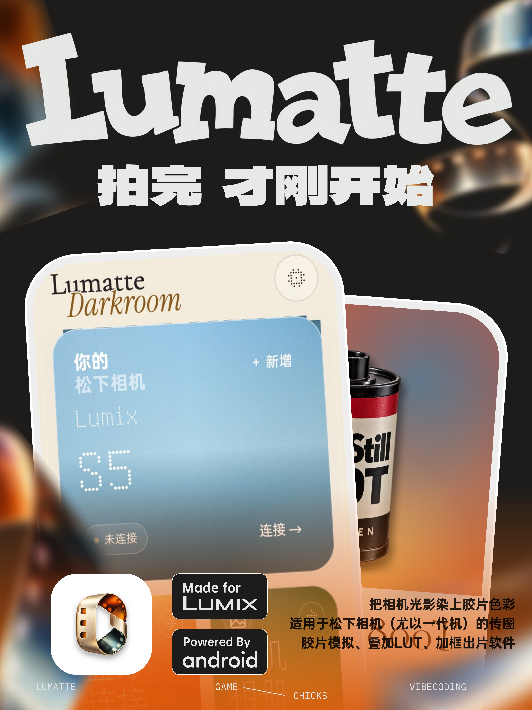
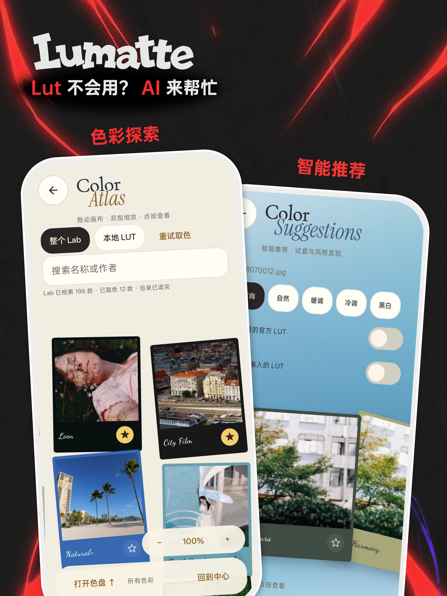
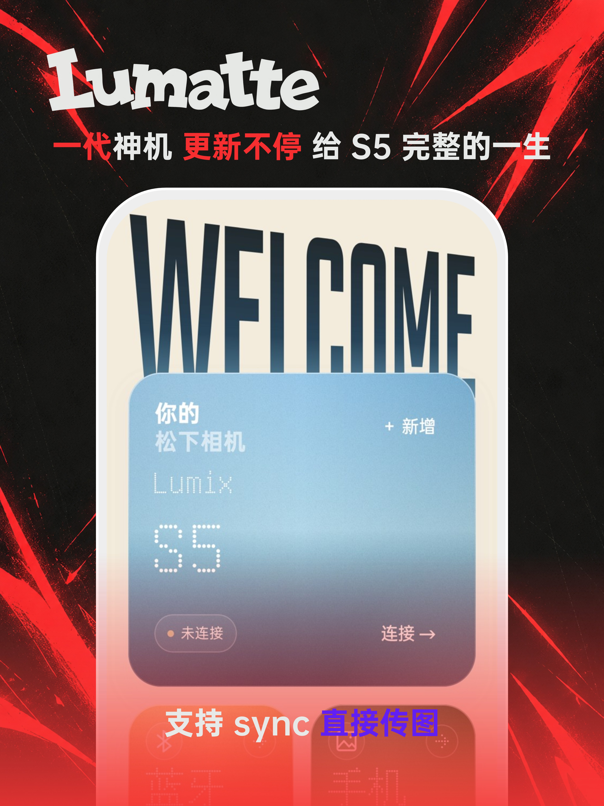
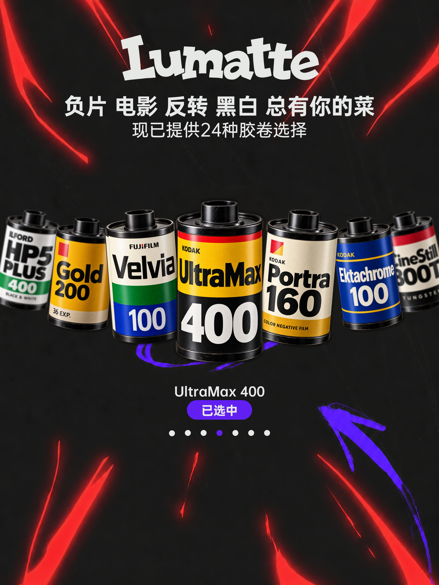
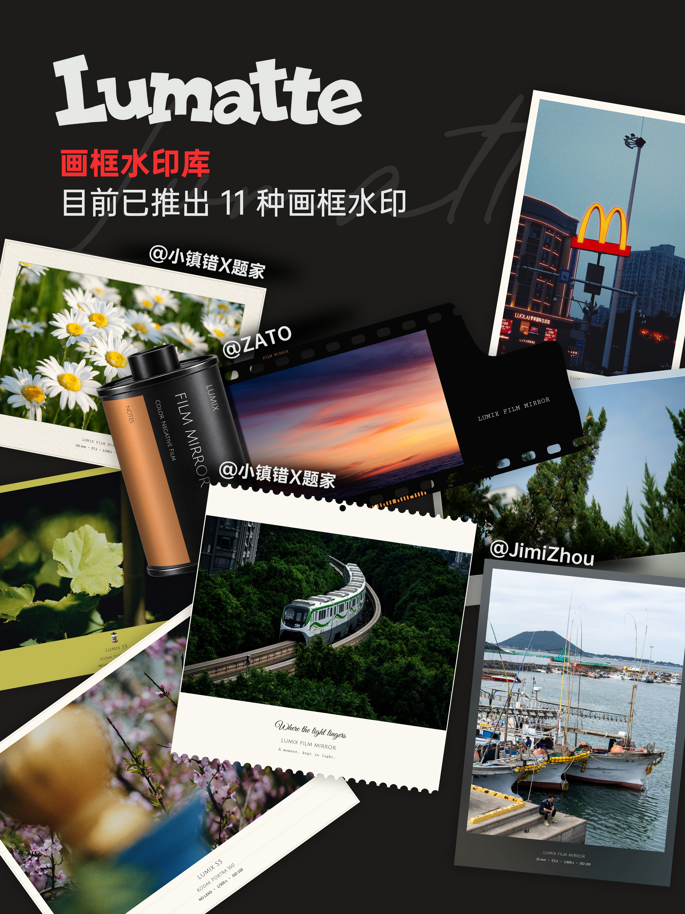
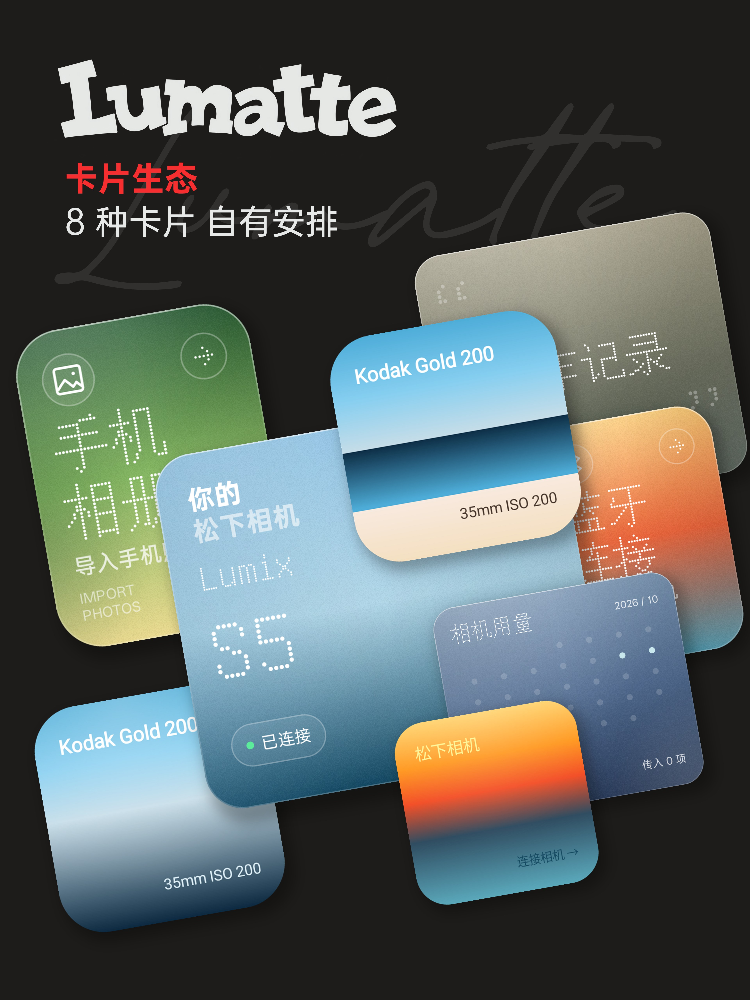
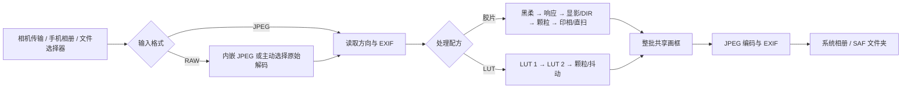
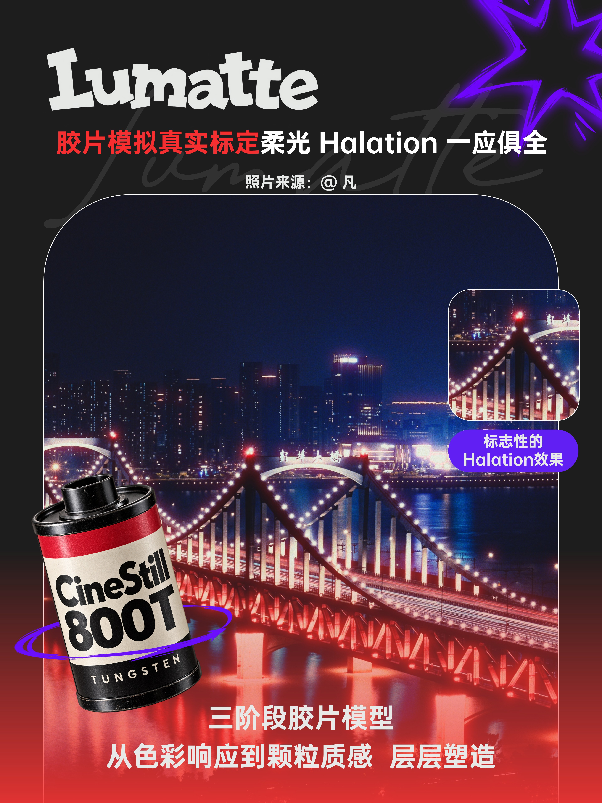

<p align="center">
  
</p>

# 松映 · Lumatte

**松映 · Lumatte** 是一款开源 Android 摄影工具。它把松下相机照片传输、移动胶片模拟、双 LUT 试套和画框导出放进同一条本地工作流，想让手机成为一间随身数字暗房。

本项目由社区独立开发，与 Panasonic / 松下没有隶属关系；LUMIX、Kodak、Fujifilm、Ilford 等商标与产品名只用于标识相机和胶片风格。最低支持 Android 11（API 30），应用 ID 为 `com.lumixfilmmirror.app`，应用代码按 [GNU GPL v3.0](LICENSE) 开源。


[下载 1.0.0 APK](https://github.com/GameChicks/Lumatte/releases/download/v1.0.0/Lumatte-1.0.0-build19-debug.apk) · [所有 Release](https://github.com/GameChicks/Lumatte/releases) · [版本记录](https://github.com/GameChicks/Lumatte/releases) · [构建说明](BUILDING.md) · [第三方许可](THIRD_PARTY_NOTICES.md)

## 1.0.1 体验版修正（versionCode 22）

- 恢复主页大相机卡片的透明文字按钮。主标签各自处理顶部安全区，切页保持固定容器并只作水平位移；操作提示改为统一圆角和轻量文字操作。
- 编辑页底栏固定高度，加入面板转场；胶卷分为全部 / 负片 / 电影 / 反转 / 黑白，小暗盒缩略图加单行短名，完整名称保留在目录和无障碍说明中。LUT 采用同一缩略图选择形式。
- 照片预览按真实长宽比居中，无额外白色底框；缩小时采用逐级低通采样，减少细颗粒在小图中的混叠，导出颗粒参数不变。黑柔标为关闭 / 1/8 / 1/4 / 1/2。
- 片边文字恢复自然字形比例、整行排字与更清晰的词间距，DX 连续模块合并绘制；深色片基与原有胶卷标签保留对应关系。增加 120 无齿孔细片边，与 135 齿孔片边分开选择，继续保留照片比例。
- 显影页移除左上角标题及底部教程，减少机身四周留白，放大相机展示；保留轻量跳过及底部显影状态。
- 新批次默认逐张独立编辑；预览下方明确显示「逐张编辑」或「整批联动」，可在此切换。已保存批次保留原来的模式与每张草稿，整批画框设置继续共享。
- CineStill 光晕合并重复的响应 / 高光门控计算，复用卷积缓冲并按连续像素处理纵向递推；保留完整渲染网格、原核与权重。单项空间场缓存上限 384 MiB，换图替换，空闲释放时清除；相同空间场无需重复上传 GPU。
- Film / LUT 的八项基础微调统一放在原图输入端，之后才应用胶片或 LUT；曝光使用线性光 2^EV 增益，不叠加成片压暗层。微调全零保留原风格，光晕基于调整后的输入生成，缓存包含全部输入微调。

本轮还修正编辑栏卡片高度与切边、统一选项胶囊样式和状态栏提示安全区；目录 / 导入选卷先应用到整组，编辑页继续逐张修改。画框面板采用固定安全区容器与单一内部滚动，构图和色彩在前、签名与拍摄信息在后；导出使用紧凑进度并为主预览保留空间。字体编辑只预览成片文字区域，隐藏不存在的自动标题，把单行文字提升为主要内容。

本轮按维护者要求仅作定向验证：10 项 JVM 检查、17 项 RAW10 / 输入调整原生数值检查、4 项合成 Bayer DNG 解码检查通过；另在隔离模拟器核对编辑弹层滚动、文字局部预览与 LUT 控件显示。模拟器后续发生系统界面异常，导出大图调整尚未完成运行验收。没有运行全面测试，也没有 S5 RW2 或骁龙 865 的真实设备耗时数据。build22 为本地体验包，下方 GitHub 下载入口仍是既有公开发布版本。

## 1.0.1 功能新增

- 进入前台时自动查找当前 Wi-Fi 上的松下相机，识别到唯一机身后完成播放初始化；多机身时交由用户选择，手动断开后不立即抢连。
- 相机下载使用 256 KiB 缓冲并限制进度回调频率；日志分别记录下载字节、耗时、速率与导入耗时。实际机型的速度仍需连接相机确认。
- 首页新增「资产库」卡片，可搜索、查看并重新编辑已导入的原片；「管理卡片」可显示或隐藏相机、蓝牙、手机相册、资产库、用量与记录卡片，不删除原片或相机记录。
- Film / LUT 编辑共用上方大预览、下方工具栏：调节、LUT、胶卷、质感、输出。调节共用一个滑杆；胶卷与双槽 LUT 在当前页横向切换，LUT 还提供当前照片的小图试套。两种模式均支持曝光、亮度、对比度、高光、阴影、饱和度、自然饱和度、色温，旧配方缺少新字段时保持中性。
- CineStill 800T / 400D 接入 [SpektraLab 固定参考](research/spektralab/README.md)的基底反射光晕，替换旧 Fotufilm 空间核和成片红色叠加；19 款色彩模型与普通胶卷、颗粒参数保持原方案。400D 使用相同光晕机制适配自己的模型，上游没有独立 400D 配置。
- 胶卷片边改为参考项目的 135 片边设计：按胶卷区分字样、点阵、片号和 DX（没有来源代码的胶卷不虚构 DX）。保留照片实际比例，包括竖图与全景；画框在胶片处理后合成，因此不是上游化学片边模拟的逐像素复刻。
- 画框页新增「日期后背」开关，对全批次生效，无边框也可开启。自动打印 EXIF 拍摄日期；缺失时采用导入副本日期。原图及其 EXIF 不改写。

本地体验包包含以上改动；定向检查范围见上文。手机、相机与图像一致性验收仍待实际设备确认。上方下载链接仍是既有公开发布版本。

## ⏬ 下载与版本

**当前版本：1.0.0（versionCode 19）**，2026-10-18 发布，最低 Android 11。

- [Lumatte 1.0.0 APK](https://github.com/GameChicks/Lumatte/releases/download/v1.0.0/Lumatte-1.0.0-build19-debug.apk)，205.2 MiB
- [Release 页面](https://github.com/GameChicks/Lumatte/releases/tag/v1.0.0) · [1.0.0 发布记录](https://github.com/GameChicks/Lumatte/releases/tag/v1.0.0)

<details>
<summary>APK 校验信息</summary>

- 文件名：`Lumatte-1.0.0-build19-debug.apk`
- 文件大小：215,163,482 字节
- APK SHA-256：`EE59734C0071C5D13451352FA23B6D2ACB506A28C7EF10A36FCDC3A829AC4778`
- Android Debug 证书 SHA-256：`1a2e67ceaad95c8d88371b23663d1e71ea587132ec2e48114705067cce4c6a41`

</details>

> ⚠️ 这个 APK 使用 **Android debug 证书签名**，适合体验和验证，不是应用商店签名包。1.0.0 发布记录中，打包、APK v2 签名、版本信息和 16 KiB 对齐检查均已核验；没有运行测试，也没有进行实体手机或相机验证。设备兼容性与实际影像效果仍需要在你自己的环境中确认。

## 📚 使用指南

### 省流模式

1. **相机直传**：相机开启蓝牙配对 → 应用首页「蓝牙连接」→ 选中相机并在相机屏幕确认配对 → 跟随提示连接相机 Wi-Fi（也可用「Wi-Fi 连接」或「同一路由器连接」）→ 进入「相机相册」多选照片 →「传入选中 · N 项」→ 选择「仅导入手机 / 进入 Film 编辑 / 进入 LUT 编辑」。
2. **本地修图**：首页「手机相册」或右上「导入照片」→ 选照片（或「从文件导入 JPEG / RAW」）→ 底部 **Film** 选胶卷，或在 **LUT** 页套用双槽 LUT → 调整曝光 / Halation / 黑柔或 LUT 强度 →「画框与导出」→ 设置画框、文字和输出 →「导出本批 · N 张」。
3. **只加画框**：底部「水印」栏直接导入原图 → 选择画框与文字 → 导出。这个入口不套胶片或 LUT 效果。

> ⚠️ 开始前至少知道三件事：
> 1. RAW 默认提取内嵌 JPEG；文件导入可主动选择传感器原始解码，产出 10bit 宽色域工作缓存，并非完整 16 位 RAW 编辑器；
> 2. 照片尺寸 100% 指「有效输入照片」的 100%，画框是在原图外**扩展画布**，不会静默缩小照片；
> 3. 1.0.0 是调试签名 APK，相机与设备兼容性尚未逐机型验证。

### 快速开始

#### 1. 安装与准备

1. 安装 1.0.0 APK（Android 11 及以上；系统可能要求允许安装未知来源应用）。
2. 查找蓝牙相机时，按系统提示授予蓝牙扫描 / 连接权限与**精确定位**权限（Android 12+ 的蓝牙权限显示为「附近设备」，Android 11 及以下只需确认位置权限；定位只用于兼容蓝牙扫描和检查系统定位开关，应用不读取手机位置）。Android 13+ 连接相机 Wi-Fi 时还会请求**附近 Wi-Fi 设备**权限。
3. 开始相机传输或导出时，系统会请求**通知**权限用于进度提示；拒绝它不会阻止照片传入。
4. 相机端先进入「蓝牙 → 配对」页面，或提前开启相机 Wi-Fi。

#### 2. 从松下相机传照片

1. **相机开启配对**：进入相机「蓝牙 → 配对」页面并保持打开。只把蓝牙设为 ON 不等于进入配对；扫描时请先退出其他 Sync 软件。
2. **选中相机**：在应用「蓝牙连接」页查找相机（最长扫描 20 秒；发现相机后可以立即点「连接」，不必等查找结束），并在相机屏幕上确认配对。
3. **连接传输网络**：应用读取到 Wi-Fi 名称 / 密码后，点「启动传输 Wi-Fi 并连接」，在系统 Wi-Fi 弹窗确认；相机已经开启 Wi-Fi 时，也可用「已在相机上开启 · 直接连接」或「连接此相机 Wi-Fi」。
4. **浏览与传输**：进入「相机相册」后是最新在前的网格分页，滚动接近末尾会加载更早的照片。多选照片后点「传入选中 · N 项」。传输期间可以暂停、取消余下任务或返回工作台；页面隐藏不等于取消。
5. **传入后去向**：可以选择「仅导入手机」「进入 Film 编辑」「进入 LUT 编辑」。视频按相机原始文件保存到 `Movies/LumixFilmMirror`，不解码、不转码，也不进入胶片 / LUT / 画框设置。
6. **拍后自动发送**：相机支持「拍后自动发送 / 相机选定发送」时，点「等待相机发送并连接」，在相机上开启后等待接收；单轮接收结束后需要再次开启，应用不会自动重连。

其他连接入口：相机已连 Wi-Fi 时用「已连 Wi-Fi · 查找相机」；手机与相机接同一路由器时用「同一路由器连接」；也可以手动输入 Wi-Fi 名称和安全类型。


#### 3. 从手机相册 / 文件导入

1. 首页快捷卡「手机相册」（副标题「导入手机照片」），或页面右上「导入照片」。
2. 选择「系统相册 · 多选照片」或「从文件导入 JPEG / RAW」。
3. 从主入口导入会**建立新批次**；在编辑页或导出页点「导入照片」则会**追加到当前批次**。
4. RAW 文件导入提供内嵌 JPEG（默认）/ 原始解码均衡 / 原始解码完整尺寸；均衡模式约为原宽高一半。原始解码模式保留 RAW，在 10bit 宽色域工作缓存上编辑。

#### 4. 选胶片或套 LUT

**胶片**

1. 底部 **Film** → 选择「负片 / 电影卷 / 反转片 / 黑白卷」→ 在纵向暗盒轮播中上下滑动选卷 → 详情页「选择此卷」。
2. Film Preview 可在当前页底部「胶卷」中横向更换胶卷，照片固定在上方。编辑页可调：**曝光**（−3.0…+3.0 EV）、**亮度、对比度、高光、阴影、饱和度、自然饱和度、色温**（−100…+100）、**胶片颗粒**（低 / 中 / 高）、**Halation 光晕**开关、**黑柔**（关闭 / 1/8 / 1/4 / 1/2）；批次可选「逐张独立」或「继承首张」。
3. 点「显影与反转 →」会按批播放一次显影动效，右上角有「跳过」；同一批再次导出不重播，设置里也可以关闭动画。
4. 继续设置画框与导出参数。

**LUT**

1. 底部 **LUT** → 顶部切换「我的 LUT」/「Lumix Lab」。
2. 在 LUT 1 / LUT 2 两个槽位分别「添加 LUT」；导入本地 `.cube` / `.vlt`，或从 Lumix Lab 浏览下载。
3. 两槽各自「强度」0–100%，可「交换两槽顺序 ↔」或「移除」；处理顺序固定为 **LUT 1 → LUT 2**。
4. 另有「颗粒效果」开关 + 强度，以及「减少色彩断层」（Bayer 抖动，在 8 位量化前）；随后点「选择画框与导出 →」。


#### 5. 批量处理

1. 一次导入多张照片即形成当前批次；工作台「当前批次」可查看张数、切换历史批次、「新建批次」或「继续导入」。
2. 新批次默认「逐张独立」（每张单独调整）。点击预览下方的模式 / 张数，可主动开启「整批联动」（后续照片沿用第一张的整套处理参数）；旧批次保留已存模式与独立草稿。
3. 继承的是**配方参数**，不会复制第一张的像素、照片 EXIF、文件名、尺寸或颗粒随机种子。
4. 整批共用**一个画框预设和一套画框设置**；每张仍使用自己的方向、EXIF、取色与片号。
5. 导出任务会持久化，失败项可以「重试失败照片」；状态为 REVIEW（保存结果不明）的照片需要先核对，不会自动重试。


#### 6. 画框与导出

1. 进入「画框与导出」页（或从底部「水印」栏直接导入原图）。
2. 顶部页签：「画框」/「文字与细节」/「输出」。
3. 「画框」提供 11 款：无边框、白色相纸、黑色画廊、胶片暗盒、记忆票根、拍立得、暮色、雾面、取色相框、典藏纸框、幻灯片夹。本批全部照片使用同一款画框。
4. 「文字与细节」：签名 / 水印文字（≤240 字）、EXIF 显示开关（机型、镜头、焦距、光圈、快门、ISO、拍摄时间）、7 款内置字体与自定义字体导入、画布比例、纸边、方向、取色策略、暗盒标签等。
5. 「输出」：图片格式（JPEG / PNG 透明底）、照片尺寸（1–100%，默认 100%）、JPEG 压缩质量（1–100，默认 95）、最终画布尺寸；保存到系统相册的 `Pictures/LumixFilmMirror`，或通过「选择文件夹」用系统 SAF 指定位置。
6. 点「导出本批 · N 张」，完成后可查看结果；导出文件名形如 `LFM-yyyyMMdd-HHmmss-SSS-<UUID>.jpg`（PNG 为 `.png`），每次导出独立，不会覆盖已有照片。


#### 7. RAW 照片

1. 导入窗口先选择 RAW 读取方式，再用「从文件导入 JPEG / RAW」选择文件。
2. 默认快速方式继续读取 RW2 / TIFF 内嵌 JPEG，必要时由 LibRaw 缩略图接口补充。
3. 原始解码实际调用 LibRaw 解包与去马赛克，采用相机白平衡、关闭自动提亮，临时解码为 16 位线性 ProPhoto D65，再存成非线性 10bit 宽色域缓存；均衡约为原宽高一半，完整尺寸采用 AHD。保留应用私有 RAW 副本，源文件不改写。
4. 原始解码失败明确报错，不静默改用内嵌 JPEG；可重新选择快速方式。完整尺寸需至少 1 GiB 当前可用内存，仍有尺寸及解码器内存限制。高精度 RAW 胶片目前使用原生 CPU 路径，JPEG 保留原 GPU 路径。这不是峰值内存保证。编辑从 10bit 缓存读取浮点数据；普通 JPEG / PNG 输出仍为 8 位，不是 10bit HEIF 或完整 16 位 RAW 编辑器。
5. 未进行实机 RAW、机型、色彩、方向或耗时验收；默认导出 100% 指实际采用的工作图尺寸。相机直接传入目前仍走原有内嵌 JPEG 方式。


#### 8. 浏览 Lumix Lab

1. 底部 **LUT** →「Lumix Lab」，浏览官方社区分类、目录、搜索、详情、创作者例图与介绍。
2. 只有你在详情页点「选择该 LUT」时，应用才下载对应的 grid17 LUT 到本地私有库；之后可以离线用于双槽、批次和导出。
3. 「今日推荐」按本地日期轮换；官方目录搜索按服务端分页遍历，可能只覆盖已读范围，不能保证覆盖全站。
4. 不批量下载 LUT，不上传照片；网络失败时会保留本地 LUT 流程。

「我的 LUT」页还有「智能推荐 ↗」与「色彩探索 ↗」入口：智能推荐会用当前照片的小图试套本地 LUT，按自然 / 暖调 / 冷调给出候选；官方未下载候选最多临时试用 5 款 grid17 LUT。黑白或几乎没有色彩的照片会提示换彩照或手动选择，不会硬推黑白效果。

> ⚠️ 从 Lumix Lab 下载的 LUT、例图与头像保留创作者权利，本项目不内置、不再分发。

<p align="center">
  
</p>

## 📝 TODO / 路线图

### ⌛ 计划内

- 相机：更多 STA 通知与机型差异、逐机型配对 / 连接验证。
- RAW：逐机型真实 RW2 文件的 JPEG / EXIF / 方向与异常文件验证。
- 更多胶卷与冲洗条件：资料整理 → 单款试点 → 移动接入 → 逐款扩展。
- LUT 智能推荐的质量完善（内容识别、偏好与更可靠的效果评分）。
- Lumix Lab 官方 LUT 下载与例图的真实网络端到端验证。
- 折叠屏 / 横屏 / 大字号布局，以及真实手机 GPU 与性能测量。

### ✅ 已完成（截至 1.0.0）

- 相机 BLE 发现 / 配对、Wi-Fi（SoftAP / STA）会话、媒体浏览、多选传输、拍后发送接收、连接日志与传输缓存清理。
- 24 款移动胶片目录（负片 10 / 电影卷 6 / 反转片 4 / 黑白卷 4），GLES 3 分块渲染 + 同模型 CPU 回退。
- CineStill 800T / 400D 的 SpektraLab 基底反射与高光门控（源码适配，见固定参考说明）。
- 双 LUT 槽、`.cube` / `.vlt` 解析、LUT 颗粒、Bayer 减少色彩断层、收藏 / 今日推荐 / 色彩探索。
- 色彩推荐改为真实照片试套（自然 / 暖调 / 冷调），排除黑白与单色 LUT，官方候选最多临时试用 5 款，已包含在 1.0.0 APK 中。
- Lumix Lab 官方目录、分类、搜索、详情与用户主动下载。
- RAW 内嵌 JPEG 提取（RW2 / TIFF 快速路径 + LibRaw 补充）。
- 批量「逐张独立 / 继承首张」、整批共享画框、持久导出任务。
- 11 款画框、8 种画布比例、7 款签名字体、EXIF 文字与自定义字体。
- 画框 PNG 透明底：JPEG / PNG 输出格式，「胶片暗盒」与「记忆票根」保留透明轮廓，已随 1.0.0 / versionCode 19 重建包交付。
- 3 种桌面小组件 × 6 种配色、首页用量、创作记录、设置与许可页。
- 1.0.0 打包与结构核验：assembleDebug、v2 签名、ZIP / ELF 16 KiB 对齐、双 ABI。

### ⭕ 评估中

- 双 LUT 组合推荐。
- 导出 / 存储在不同系统版本与 SAF 提供方上的行为。
- 新的黑白与彩色胶片模型（草稿接口存在，尚无真实新模型）。

### ⛔ 明确不做

- ~~相机实时取景、遥控拍摄、视频启停、曝光 / 白平衡 / 对焦控制、相机参数复制与远程电源~~ —— 相机功能只做连接、浏览和传输。
- 自建 LUT 服务器，或内置 / 再分发 Lumix Lab 创作者内容。
- 完整 16 位 / HDR RAW 色彩管理和高位深成片输出（当前提供 10bit 缓存与浮点处理，普通 JPEG / PNG 输出仍为 8 位）。
- Vulkan 参考渲染后端（已从源码树移除）。
- Portra 800 Push1 / Push2 运行时模型（旧配方按普通 Portra 800 渲染）。

## 🚀 主要特性

### 📷 相机连接与传输

<p align="center">
  
</p>

- BLE 发现、配对，以及相机 Wi-Fi 的 SoftAP / STA 两种连接方式。
- 相机相册网格浏览、最新在前倒序分页、多选与「选择已载入」。
- 下载队列支持暂停 / 继续 / 取消余下、断点文件与前台服务通知；断线或进程结束后队列保留，由你重新连接后继续。
- 「拍后自动发送 / 相机选定发送」接收；单轮接收结束后需要再次开启。
- 连接日志与诊断：默认记录，可查看、导出 `.log`、清除；单份 ≤256 KiB、最多 8 份，不上传。
- 可查看传输缓存占用并清理本应用登记的中间文件，不删除工作台照片与已发布成片。
- **相机边界**：不提供实时取景、遥控快门、视频启停、曝光 / 白平衡 / 对焦控制、相机参数复制或远程电源。

### 🎞️ 移动胶片

<p align="center">
  
</p>

- 24 款目录：负片 10、电影卷 6、反转片 4、黑白卷 4。
- 分阶段模型：响应（response）→ 显影（development）→ 印相 / 直扫（scan）。
- 控制：曝光 −3.0…+3.0 EV、亮度、对比度、高光、阴影、饱和度、自然饱和度、色温（−100…+100）、颗粒低 / 中 / 高、Halation 开关、黑柔（关闭 / 1/8 / 1/4 / 1/2）。预览页通过分类浮层直接换卷，不返回选型页；横向选择调节项目，下方仅显示一根滑杆，支持当前项重置与微调归零。更换胶卷保留所有微调和颗粒档位。
- 逐张独立编辑，或让整批继承第一张的处理参数。
- CineStill 800T / 400D 使用专用 SpektraLab 基底反射与高光门控；胶片色彩模型按同型号优先使用 Fotufilm，普通胶卷仍保留既有光晕参数与有界空间采样。
- 显影 / 反转播放动效，每批一次、可跳过，可在设置中关闭。
- 目录中的模型是移动端的风格模拟，不是对真实胶卷或桌面引擎的逐像素复刻。

### 🧪 双 LUT

<p align="center">
  
</p>

- 两个顺序槽：LUT 1 → LUT 2，各自 0–100% 强度，可交换顺序或只用一槽。
- 支持 `.cube`（1D / 3D / 1D shaper + 3D）与松下 `.vlt`（17³，严格校验）；非法尺寸、缺行、越界或冲突的输入域声明会被拒绝。
- 本地导入不改写原文件，按源文件 SHA-256 生成应用私有缓存。
- 内置 10 款用户提供的 LUT，保留原作者注释与来源。
- LUT 颗粒开关 + 强度、Bayer「减少色彩断层」。
- 收藏 / 今日推荐 / 色彩探索 / 智能推荐：拍立得收藏页、按本地日期轮换的推荐，以及用当前照片试套本地 LUT 的智能推荐入口。
- **边界**：需与源照片输入色彩匹配；不自动识别 / 转换 V-Log；没有 LUT 导出或 `.vlt` ↔ `.cube` 互转。

### 🖼️ 画框、水印与导出

<p align="center">
  
</p>

- 11 款画框、8 种画布比例、纸边 2%–12%，画布方向可跟随照片或强制横 / 竖。
- 签名 / 标题 / 副标题 / 页脚文字，7 款内置字体，支持导入 TTF / OTF / TTC（≤32 MiB）。
- EXIF 文字逐项开关，开关应用于整批；每张照片只显示实际检测到的数据。
- 照片尺寸与 JPEG 压缩质量独立：默认 100% / 95；画框扩展画布，不静默缩小原图。
- 「输出」可选 JPEG（默认）或 PNG 透明底：透明底只对「胶片暗盒」「记忆票根」生效，暗盒、胶片条、纸票、齿边、照片与文字照常绘制，其余画框保留自身底色；PNG 不写 EXIF，也不使用压缩质量。
- 保存到系统相册 `Pictures/LumixFilmMirror` 或 SAF 自选文件夹；导出文件名 `LFM-…`，独立不覆盖。
- 「水印」栏可对原图直接加画框，不套胶片或 LUT 效果。

### 🖥️ 工作台、首页与桌面

<p align="center">
  
</p>

- 工作台：批次切换 / 新建 / 继续导入、传输与导出任务、JPG 导出设置、LUT 调色、导出中间文件与自选文件夹记录、缓存清理。
- 首页：Lumatte / Darkroom 标题、相机卡片、手机相册入口、相机用量（本月拍摄 / 传入数量）、创作记录。
- 设置：外观（跟随系统 / 浅色 / 深色）、动态与交互、JPEG 输出、素材、任务与存储、支持开发、关于与许可。
- 桌面小组件：柔光胶卷 / 分层胶卷 / 相机连接 3 种样式 × 6 种配色，先配置后添加。
- 主界面固定四栏：**连接 / Film / LUT / 水印**。

### 🔒 本地与隐私

- 照片解码、配方计算、预览和导出都在设备本地完成，不上传照片。
- 相机 HTTP 绑定到用户选择的 Wi-Fi 网络，并限制在相机需要的私有 / 链路本地地址；外部 LUT / Lab 客户端独立使用 HTTPS。
- 不保存相机 Wi-Fi 密码或相机会话令牌；连接日志不记录密码、SSID、MAC、会话 ID 或照片文件名。
- 照片通过系统照片选择器 / SAF 读取与导出，不需要存储权限；应用已关闭系统备份。

## 🔧 核心功能详解

### 处理管线



照片进入应用后，先确定输入格式：JPEG 直接读取方向与 EXIF；RAW 默认提取内嵌 JPEG，也可主动选择传感器解码为无损 sRGB 工作图，再走同一套流程。之后按选择进入胶片或 LUT 处理，完成后添加整批共享画框，编码 JPEG、写入 EXIF，并发布到系统相册或用户选择的 SAF 文件夹。

### 移动胶片：分阶段模型与有界渲染

<p align="center">
  
</p>

- 胶片数据不是把 `.cube` 换个名字：模型拆成响应、显影、印相 / 直扫三个阶段，由预先生成并校验来源的数值表驱动；19 款 Fotufilm 派生模型 + 5 款原有 SpektraFilm 模型组成当前 24 款目录。同型号存在于 Fotufilm 就迁移，缺少的 Portra 160 / 800、Velvia 100、Vision3 50D / 200T 保留原模型；详见 [固定模型输入与映射](research/fotufilm/model-reference-e15b098/README.md)。
- 渲染后端优先使用 GLES 3 图块扫描；遇到可识别的 GPU / 驱动类失败时，丢弃未完成结果，从原始 JPEG 重新用同模型 CPU 后端重做。CPU 与 GPU 使用同一配方与模型，但浮点计算与 8-bit 编码差异意味着不承诺逐像素完全相同。
- 普通胶卷的空间效果与黑柔沿用有界分析网格；CineStill 800T / 400D 的基底反射使用当前渲染尺寸的完整网格、四组带符号高斯核与高光门控。预览与导出复用同一路径，但没有进行图像或 GPU 驱动一致性验收。
- 胶片颗粒按每张照片的种子生成，强度提供低 / 中 / 高三档（噪声振幅 0.4× / 1× / 1.5×），默认中档保持原强度。继承首张只共享参数，不复制噪声种子。旧配方缺少新字段时恢复为中档颗粒、零微调。
- 画框在胶片渲染完成后添加，不做边框 / 水印检测。


### 24 款胶片目录

| 分类 | 数量 | 胶卷 |
| --- | --- | --- |
| 负片 | 10 | Fujifilm C200、Fujifilm Pro 400H、Fujifilm X-Tra 400、Kodak Ektar 100、Kodak Gold 200、Kodak Portra 160、Kodak Portra 400、Kodak Portra 800、Kodak Ultramax 400、CineStill 400D |
| 电影卷 | 6 | Kodak Verita 200D、Kodak Vision3 50D、Kodak Vision3 250D、Kodak Vision3 200T、Kodak Vision3 500T、CineStill 800T |
| 反转片 | 4 | Fujifilm Provia 100F、Fujifilm Velvia 100、Kodak Ektachrome 100、Kodak Kodachrome 64 |
| 黑白卷 | 4 | Fujifilm Acros 100 II、Kodak Tri-X 400、Ilford HP5 Plus 400、Ilford Delta 3200 |

> 24 款都是移动端的风格模拟，不是实测胶卷，也不代表完整桌面引擎的逐像素结果。另有旧配方中的两款 Silver 黑白风格仍可渲染，但不在新选卷目录中。

### 双 LUT：顺序混合与可重复配方

- 槽 1 的结果作为槽 2 的输入；两槽各自强度，0% 等于原输入，不会悄悄替换原图。
- `.cube` 支持 1D、3D、1D shaper + 3D；`.vlt` 按松下 17³ 色表读取，要求输出 0–4095 整数与 4913 行。
- 导入文件上限 32 MiB；严格 UTF-8、完整行数、有限数值与输入域校验；冲突的 `DOMAIN_MIN/MAX` 或输入范围声明会被拒绝。
- 渲染优先走原生 CPU 后端，不可用时回退 Kotlin CPU 实现；颗粒与减少色彩断层在 8 位量化前处理。
- 预览与整张成片复用同一处理计划，但预览分辨率与最终照片不同，不承诺噪声逐像素一致。
- 智能推荐用当前照片的小图采样与特征排序，官方候选会临时试用最多 5 款真实 grid17 LUT。它是有边界的色彩启发式，不是题材识别或全库最佳审美判断；准确率与阈值尚未在真实照片集上校准。


### RAW：快速预览与可选原始解码

- 优先从 RW2 / TIFF 元数据读取内嵌 JPEG；需要时由固定版本 LibRaw 的 JPEG-only 缩略图接口补充读取。
- 文件导入的原始解码选项调用固定 LibRaw 的 unpack / dcraw_process；原始源码、哈希与许可不变，不加入可选外部解码 SDK。
- 最终尺寸按所选方式产出的实际工作图计算；原始解码保留 RAW，均衡模式降低去马赛克工作尺寸，完整尺寸保留有效像素。缓存每像素 32 位，含三个 10 位通道；插值与微调在浮点中执行，只有预览和最终普通 JPEG / PNG 降为 8 位。保留 RAW 不等于能恢复已经饱和的传感器高光。


### 相机连接与传输

- 分层连接：BLE 用于发现、配对和读取连接信息；Wi-Fi 会话用于浏览媒体目录与下载已选资源。
- HTTP 请求绑定用户选择的 Wi-Fi Network，并限定在相机需要的私有 / 链路本地地址范围；不保存 Wi-Fi 密码或相机会话令牌。
- 下载任务写入可恢复队列，记录相机、媒体资源、进度和导入阶段；暂停或进程结束后，队列等待你重新连接并继续核对。应用启动时不会擅自重连相机。
- 协议按 LUMIX Sync 官方机型范围实现：S1H、S1R、S1、S5M2、S5M2X、S5、S9、BS1H、GH5M2、GH6、GH7、G9M2、G97、G100（含 DC-G110 地区别名）、G100D、BGH1，以及 limited 支持的 GH5、G9、GH5S。全部尚未逐机型验证，列表只表示协议覆盖范围。


### 批量与导出

- 批次是工作台里的照片分组；导出快照包含照片顺序、每张有效配方、种子、共享画框、尺寸 / 质量和目标。
- 导出阶段：PREPARING → RENDERING → FRAMING → ENCODING → PUBLISHING（无画框时省略 FRAMING）。
- 发布使用临时文件与完成记录，尽量把已完成结果与正在处理的中间文件区分开；发布目标为系统相册 MediaStore 或 SAF 文件夹。
- 视频按原文件保存，不进入照片管线。


### 画框与水印

- 画框页预览调用真实画框渲染器，小样与主预览一致。
- 画框文字可以使用每张照片自己的 EXIF 信息；机型号会按规则显示为 `Lumix S5` 等，无法识别时保留原样，缺失不推测。
- 取色相框和胶片暗盒支持自动取色 / 暖白 / 黑色纸面与 6 种 mood（炽烈 / 清曜 / 棠梨 / 尘霭 / 霜月 / 侘寂）；取色相框支持导入装饰图。


## ⚙️ 参数与设置速查

### 胶片参数

| 参数 | 取值 | 说明 |
| --- | --- | --- |
| 曝光 | −3.0…+3.0 EV | 单一曝光控制 |
| Halation 光晕 | 开 / 关 | 仅 CineStill 800T / 400D 走专用物理返光，其他胶卷用默认路径 |
| 黑柔 | 关闭 / 1/8 / 1/4 / 1/2 | 镜头柔光 |
| 批处理模式 | 逐张独立 / 继承首张 | 继承只共享处理参数 |
| 显影与反转动画 | 开 / 关 | 每批一次，可跳过 |

### LUT 参数

| 参数 | 取值 | 说明 |
| --- | --- | --- |
| LUT 1 / LUT 2 | 各 0–100% 强度 | 顺序固定，槽 2 以槽 1 结果为输入 |
| 颗粒效果 / 强度 | 开 / 关；0–100% | LUT 路径的颗粒 |
| 减少色彩断层 | 开 / 关 | Bayer 4×4 抖动 |
| 导入格式 | `.cube` / `.vlt` | 单文件 ≤32 MiB，非法输入拒绝 |

### 画框与文字

| 参数 | 取值 | 说明 |
| --- | --- | --- |
| 画框 | 11 款 | 整批共用同一款 |
| 画布比例 | 原比例 / 1:1 / 3:2 / 4:3 / 7:6 / 5:4 / 15:9 / 2:1 | 画框扩展画布 |
| 纸边 | 2%–12% | 可调纸边宽度 |
| 画布方向 | 跟随照片 / 横向 / 竖向 | |
| 签名文字 | ≤240 字 | |
| 字体 | 7 款内置 + 导入 TTF / OTF / TTC（≤32 MiB） | |
| EXIF 字段 | 机型 / 镜头 / 焦距 / 光圈 / 快门 / ISO / 时间 | 逐项开关，应用于整批 |

### 输出

| 参数 | 取值 | 说明 |
| --- | --- | --- |
| 图片格式 | JPEG（默认）/ PNG 透明底 | PNG 不写 EXIF、不使用压缩质量；透明只对「胶片暗盒」「记忆票根」生效 |
| 照片尺寸 | 1–100%，默认 100% | 100% 表示保留有效输入照片的像素尺寸 |
| JPEG 压缩质量 | 1–100，默认 95 | 与照片尺寸是两个独立设置 |
| 保存位置 | 相册 `Pictures/LumixFilmMirror` / SAF 文件夹 | 通过系统相册或 SAF 发布 |

## 📱 兼容与已知限制

| 项目 | 现状 |
| --- | --- |
| Android | 11+（API 30），compileSdk / targetSdk 36 |
| ABI | arm64-v8a、x86_64（仅 64 位） |
| 相机 | 按 LUMIX Sync 官方机型范围实现协议，19 款机型全部未逐机型验证 |
| RAW | 默认内嵌 JPEG；文件导入可选原始解码为 10bit 宽色域工作缓存 |
| 输出 | JPEG（默认）或 PNG 透明底；PNG 透明只对「胶片暗盒」「记忆票根」生效，不写 EXIF；视频按相机原文件保存，不进入胶片 / LUT / 画框流程 |
| LUT | 输入需与源照片色彩空间匹配；无 LUT 导出 / 互转 |
| Lumix Lab | 依赖官方服务；只在你主动选择时下载 LUT，可能受网络与服务状态影响 |
| APK | debug 签名，没有应用商店版本 |
| 测试 | 没有 CI 与自动测试钩子；JVM 检查只在维护者明确要求时手动运行 |

## 🎨 使用场景

### 夜晚与灯光

CineStill 800T、Vision3 500T 这类高感彩色卷适合处理夜景、霓虹和灯光场景；CineStill 的专用返光路径会保留高光周围的暖色光晕。

### 城市街头与日光

Gold 200、C200、Ultramax 400、Ektar 100 适合日常街拍、旅行记录和晴天户外，色彩取向从日常暖调到鲜明的彩色负片观感。

### 人像与日常

Portra 160 / 400 / 800 与 Pro 400H 常被用来处理人像和日常片段；Ektachrome 100、Provia 100F、Kodachrome 64 提供更明确的色彩取向。

### 风景与旅拍

Velvia 100、Provia 100F、Ektachrome 100 适合风光、建筑和自然环境；需要更干净的现代负片观感时可以用 Ektar 100。

### 黑白

Acros 100 II、Tri-X 400、HP5 Plus 400、Delta 3200 覆盖从细颗粒到高感光粗颗粒的黑白取向。

### LUT 工作流

已经有喜欢的 `.cube` / `.vlt` 时，用双槽顺序叠加、强度混合和颗粒控制做自己的风格；想找新的 LUT 时，可以从 Lumix Lab 浏览官方社区作品，再在本地试套。

### 相机直传后批量出片

用相机 Wi-Fi 把一组照片传入手机，选一卷胶卷或一套 LUT，设好共享画框和输出参数，一次导出整批。

## 📡 技术支持

### 技术栈

- **语言与界面**：Kotlin 2.2.20、Jetpack Compose（Material 3，Compose BOM 2025.10.00）、Kotlin 协程 1.10.2。
- **数据与存储**：Room 2.8.5（工作台数据库）、DataStore Preferences（设置）。
- **原生与影像**：C++20 + JNI + NDK 28.2.13676358 + CMake 3.22.1；OpenGL ES 3.0 分块胶片渲染 + CPU 后备；LUT 原生 CPU 扫描；LibRaw 0.22.2（LGPL-2.1）用于内嵌 JPEG 提取及主动选择的 RAW 原始解码。
- **网络**：OkHttp 4.12.0，用于相机 HTTP 与 Lumix Lab HTTPS。
- **构建**：AGP 8.13.2、Gradle 8.13、JDK 17，compileSdk / targetSdk 36，minSdk 30，ABI arm64-v8a / x86_64。
- **架构**：`app` + 6 个 core 模块 + 3 个 native 子项目；Compose 状态驱动界面，模块之间保持明确的数据契约。
- **测试**：仓库没有 CI 与自动测试钩子；JVM 合同检查仅在维护者明确要求时手动运行，不替代设备、相机或 GPU 验证。

### 从源码构建

环境：

- JDK 17
- Android SDK Platform 36、Build Tools 35.0.0、Platform Tools
- Android NDK `28.2.13676358`、CMake `3.22.1`
- [Gradle 8.13](https://gradle.org/releases/)，自行安装并加入 PATH

Windows PowerShell：

```powershell
git clone https://github.com/GameChicks/Lumatte.git
cd Lumatte
$env:JAVA_HOME = 'D:\Android\jdk-17'
$env:ANDROID_HOME = 'D:\Android\Sdk'
.\tools\build_android_prototype.ps1
```

macOS / Linux：

```sh
git clone https://github.com/GameChicks/Lumatte.git
cd Lumatte
gradle :app:assembleDebug
```

构建脚本只由维护者手动调用，不自动运行测试、启动模拟器或上传构建结果。交付 APK 与日志写入 `dist/`；SDK、JDK、AVD、Gradle 缓存和签名材料由本机环境管理，不随源码提交。更多环境说明见 [BUILDING.md](BUILDING.md)。

### 工程结构

| 路径 | 内容 |
| --- | --- |
| `app/` | Android 应用入口、Compose 界面、工作台协调、前台服务、桌面小组件与平台集成 |
| `core/model/` | 纯 Kotlin 领域模型：照片配方、LUT 槽、批次、画框与导出选项 |
| `core/design/` | Compose 设计系统：主题、材质、排版、共用组件与已许可字体资源 |
| `core/media/` | JPEG / RAW 内嵌预览导入、胶片 / LUT 渲染、预览、画框合成、JPEG 编码与发布 |
| `core/camera/` | 松下相机 BLE 与 Wi-Fi 会话、目录浏览、HTTP 媒体请求与相机协议 |
| `core/storage/` | Room 工作台数据库、DataStore 偏好、持久导出队列与配方编解码 |
| `core/transfer/` | 下载 / 接收队列、传输阶段、断点恢复与传输缓存清理 |
| `native/mobile-film/` | 胶片分阶段模型的 C++ CPU 与 GLES 3 JNI 后端 |
| `native/lut/` | LUT 像素扫描的 JNI / C++ 后端 |
| `native/raw-preview/` | LibRaw 内嵌 JPEG 提取与可选 RAW 原始解码 JNI |
| `third_party/libraw/` | 固定版本 LibRaw 源码、来源清单与许可 |
| `research/fotufilm/` | 固定的模型生产输入、原始方程、来源哈希与许可 |
| `tools/` | 手动构建、模型生产与专项验证脚本 |

### 反馈与贡献

欢迎通过 [GitHub Issues](https://github.com/GameChicks/Lumatte/issues) 报告问题或提出建议。

- **相机问题**：请附相机型号、手机型号、Android 版本和连接方式（蓝牙 / SoftAP / STA），并尽量附上「连接日志与诊断」中导出的 `.log`。
- **照片 / 导出问题**：请说明输入格式（JPEG / RAW）、使用的胶卷或 LUT、参数与导出选项，以及是否属于批量任务。
- **功能建议**：描述你期望的使用场景即可，不必先给出实现方案。
- 公开上传样片或日志前，请先移除不愿公开的 EXIF、定位信息、账号标识和个人照片。

## 🙏 开源库与素材鸣谢

感谢这些项目与创作者，Lumatte 才能做到今天的样子。

### 影像与模型

| 组件 | 版本 / 固定点 | 许可 | 用途 |
| --- | --- | --- | --- |
| [LibRaw](https://www.libraw.org/) | 0.22.2（固定 commit `b93f6e45…`） | LGPL-2.1（本项目选择的许可选项） | 内嵌 JPEG 提取及主动选择的 RAW 解包 / 去马赛克 |
| [SpektraFilm](https://github.com/andreavolpato/spektrafilm)（Andrea Volpato） | 固定 commit `3bb2c2d2…` | CC BY-SA 4.0 | 5 款尚无同型号 Fotufilm 配置的模型；保留既有颗粒／空间参数的来源署名 |
| [Fotufilm](https://fotufilm.com/)（MUAStudio Inc.） | 配置固定 commit `e15b0981…`，公开生成器另记 SHA-256 | 配置 / 派生表 CC BY-SA 4.0，方程适配 Apache-2.0 | 19 款移动胶片色彩模型；保留旧光晕来源资料，当前 CineStill 空间路径另见 SpektraLab |

### Android / Kotlin 生态

- AndroidX Activity、Compose、Lifecycle、Room、DataStore、ExifInterface、Palette、DocumentFile（Apache-2.0）
- Kotlin 2.2.20 与 kotlinx-coroutines 1.10.2（Apache-2.0）
- [OkHttp](https://square.github.io/okhttp/) 4.12.0 与 Okio（Apache-2.0）
- Gradle 8.13、AGP 8.13.2（Apache-2.0，构建工具）

### 字体与内置素材

- SIL OFL 1.1 字体：Cormorant Garamond、Dancing Script、Great Vibes、Instrument Serif、Playfair Display、Source Han Serif / Sans、Teko、Bebas Neue、金字社统圆体（界面子集，改名为 Pineframe Tongyuan UI）；画框另使用 Cutive Mono、Abril Fatface、Julius Sans One（同样为 OFL 1.1）。
- OPPO Sans 4.0：按 OPPO Sans Fonts License Agreement 随应用捆绑，原字体逐字节保留，不单独分发
- 栗壳坚坚体（LikeJianJianTi）：中文 LUT 名称；作者为栗壳字库，来源与 SHA-256 记录见[字体来源清单](third_party/provenance/font-sources.json)
- 10 款用户提供的 LUT：Fresh Bright、Kitaura、Smoky Color-S、Teal Flat-S、VOL 23 TXD AgfaPhoto LeBox、千禧回声 cold / warm、Backlight-N、Clear-S、Color Harmony；保留原作者与文件注释
- 38 张恢复画框 / 胶卷图片与 26 张共享暗盒：来自维护者自有旧 APK，来源与 SHA-256 记录见 `core/media/src/main/assets/frames/manifest.json` 与[共享暗盒清单](third_party/provenance/shared-cartridge-sources.json)
- 应用图标与暗盒视觉：由维护者授权提供 / 生成

### 特别致谢

- [Lut2Photo-Android](https://github.com/qh7574/Lut2Photo-Android)（MPL-2.0）：Bayer 抖动与亮度颗粒的算法思路参考；本项目独立实现，**未打包该项目的源码或二进制**。

## 📜 许可

Lumatte 应用代码采用 [GNU GPL v3.0](LICENSE)。第三方代码、胶片模型、字体、LUT 和图片继续遵循各自的许可、署名和来源要求，完整记录见 [THIRD_PARTY_NOTICES.md](THIRD_PARTY_NOTICES.md)。

维护者于 2026-10-18 授权栗壳坚坚体、10 款用户提供的 LUT 和恢复画框图片随 `GameChicks/Lumatte` 项目与 1.0.0 APK 公开发布。这些素材仍保留原作者权利和来源记录；该授权不会把它们改为 GPLv3，也不替代原作者许可。

从 Lumix Lab 下载的官方 LUT、例图与头像保留创作者权利，本项目不内置、不再分发。LUMIX、Panasonic 及其他商标归其所有者，本项目不是松下官方软件。

## ☕ 支持项目

Lumatte 免费使用，没有广告，也没有账号。如果这个项目帮到了你，可以在「设置 → 支持开发」找到支付宝 / 微信的自愿捐赠入口。

**维护**：[GameChicks](https://github.com/GameChicks)

---

🌟 **喜欢这个项目吗？记得给个 Star ⭐**

📖 **项目地址**：<https://github.com/GameChicks/Lumatte>
