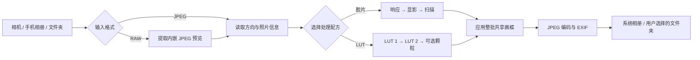

# 松映 · Lumatte

**松映 · Lumatte** 是一款开源 Android 摄影工具。它把松下相机照片传输、移动胶片模拟、双 LUT 试套和画框导出放在同一条本地工作流中，目标是让手机成为一间随身数字暗房。

本项目由社区独立开发，与 Panasonic / 松下没有隶属关系。最低支持 Android 11（API 30），应用 ID 为 `com.lumixfilmmirror.app`。

[下载 1.0.0 APK](https://github.com/GameChicks/Lumatte/releases/download/v1.0.0/lumix-film-mirror-prototype-1.0.0-20261018-101812-debug.apk) · [所有 Release](https://github.com/GameChicks/Lumatte/releases) · [版本记录](docs/releases/CHANGELOG.md) · [构建说明](BUILDING.md) · [第三方许可](THIRD_PARTY_NOTICES.md)

## 主要功能

| 功能 | 当前能力 |
| --- | --- |
| 相机连接与传输 | BLE 发现和配对、Wi-Fi 会话、相机媒体浏览、多选下载、发送队列接收、暂停与继续 |
| 移动胶片 | 负片、电影卷、反转片和黑白风格；曝光、柔光与 Halation 等配方参数 |
| LUT | 导入 `.cube` / `.vlt`，两个处理槽可分别设置强度并调整顺序；颗粒和导出选项独立控制 |
| RAW 照片 | 读取 RAW 文件中相机嵌入的 JPEG 预览 |
| 批量编辑 | 每张照片单独编辑，或显式继承第一张的处理参数 |
| 导出 | 胶片或 LUT 完成后添加画框，保存到系统相册或用户选择的文件夹 |

## 从输入到成片

下面是主要照片处理路径。相机传输是可选输入来源；普通手机相册和系统文件选择器也可提供照片。



## 技术原理

### 项目分层

界面、产品规则、Android 平台能力和高负载像素计算分开放置。这样可以单独理解或替换影像后端，同时让批量配方、存储和相机传输拥有明确的数据契约。

| 模块 | 职责 |
| --- | --- |
| `app/` | Android 应用入口、Compose 界面、工作台协调、系统服务和平台集成 |
| `core/model/` | 照片配方、LUT 槽、批次与画框等不依赖界面的数据模型 |
| `core/media/` | JPEG / RAW 预览导入、影像处理、预览、编码和照片发布 |
| `core/camera/` | BLE、Wi-Fi、相机目录发现、HTTP 媒体请求及相机协议 |
| `core/transfer/` | 下载队列、传输阶段、断点文件和接收处理 |
| `core/storage/` | Room 工作台数据库、批次、记录和 DataStore 设置 |
| `core/design/` | 主题、排版、共用设计组件与已许可字体资源 |
| `native/mobile-film/` | 胶片模型的 C++ CPU 与 GLES 3 渲染后端 |
| `native/lut/` | 高负载 LUT 像素扫描的 JNI / C++ 后端 |
| `native/raw-preview/` | LibRaw JPEG 预览提取 JNI；不提供传感器显影接口 |
| `third_party/libraw/` | 构建所需固定版本源码、来源清单和许可 |
| `research/fotufilm/` | 固定的模型生产输入、原始方程与来源哈希 |

核心 Android 代码使用 Kotlin、Jetpack Compose、协程、Room 和 DataStore；原生处理通过 JNI 接入 NDK/C++。各模块入口和当前实现边界见下方[工程文档](#工程文档与进一步阅读)。

### 胶片模拟：分阶段模型与有界处理

胶片渲染并不是把一个 `.cube` 文件换个名字。Lumatte 将胶片数据拆成响应（response）、显影（development）和扫描/印相（scan）阶段，由预先生成并校验来源的模型表驱动。曝光、柔光、Halation 和颗粒在相应阶段参与计算；完成胶片处理后才进入共享画框与 JPEG 输出。

移动设备的内存和带宽有限，因此渲染后端按图块处理，避免建立多份全分辨率浮点图像。GLES 3 路径使用独立影像 worker 与受限图块；当遇到可识别的 GPU 资源或驱动故障时，会丢弃未完成结果，从原始 JPEG 重新开始 CPU 路径。取消任务不会把半成品当作可导出照片。CPU 与 GPU 使用同一配方和模型，但浮点计算及 8-bit 编码差异意味着不承诺逐像素完全相同。

空间效果也使用分析网格，而非对每种胶卷都建立全尺寸卷积缓冲。普通胶卷沿用默认的有界空间路径；CineStill 800T / 400D 使用 Fotufilm 物理返光方程拟合的专用光晕核和更高空间采样预算。返光模型仍是对胶片光学行为的移动端实现，不代表对真实胶片、相机 JPEG 高光或桌面模型的逐像素复现。空间网格的尺寸不是整个应用内存上限，原图解码、方向校正和最终输出仍需完整位图。

### LUT：顺序混合与可重复配方

LUT 处理把槽 1 的结果作为槽 2 的输入。两个槽各自控制强度，用户可以交换顺序或只使用一个槽；关闭/零强度不会悄悄替换原图。`.cube` 解析支持 1D、3D 及 1D shaper + 3D 结构；`.vlt` 按松下 17³ 色表格式读取。非法尺寸、缺行、越界值或冲突的输入域声明会被拒绝，避免用猜测的解析方式生成颜色。

本地 LUT 导入经系统文件选择器完成；原始文件不会被改写，应用生成按源文件 SHA-256 标识的私有缓存。预览和整张成片复用同一处理计划，但缩略预览的分辨率与最终照片不同，因此不能期待颗粒噪声逐像素一致。详细格式行为以 [LUT 管线说明](docs/engineering/lut-pipeline.md) 为准。


### 导出：质量、尺寸、画框分开管理

一张照片的输出顺序是：读取有效 JPEG 与方向 → 执行选定的胶片或 LUT 配方 → 应用整批共享的画框 → 编码 JPEG → 写入 EXIF → 发布到系统相册或 SAF 文件夹。批量任务可保留每张独立配方，也可让后续照片采用第一张的参数；照片各自的 EXIF、方向和身份仍单独读取。画框文字可以使用每张照片自己的 EXIF 信息。

将照片尺寸设为 100% 表示保留当前有效输入的像素尺寸。调低尺寸不会改变 JPEG 压缩质量；调低压缩质量也不会缩小照片尺寸。发布采用临时文件和完成记录，尽量将已完成结果与正在处理的中间文件区分开。详细持久化与恢复边界见[照片批次](docs/engineering/processing-batches.md)和[JPEG 导出生命周期](docs/engineering/jpeg-export-lifecycle.md)。

### 相机连接与传输

相机功能采用分层连接流程：BLE 用于发现设备、配对和连接信息；Wi-Fi 会话用于浏览媒体目录和下载已选资源。HTTP 请求绑定到用户选定的 Wi-Fi 网络，并限定在相机需要的私有或链路本地地址范围。应用不保存 Wi-Fi 密码或相机会话令牌。

下载任务写入可恢复队列，记录相机、媒体资源、进度和导入阶段。暂停或进程结束后，队列可以等待用户重新连接并继续核对；应用不会在启动时擅自重连相机。照片导入与视频原文件保存是不同路径：视频不进入胶片、LUT、画框或照片尺寸设置，也不在导入时转码。相机协议实现和限制见[协议记录](docs/protocol/lumix-sync.md)。

### 本地处理与网络边界

照片解码、配方计算、预览和导出在设备本地执行。官方 LUT 目录浏览会访问目录或创作者示例图；只有用户选择某项后才请求下载对应 LUT。照片内容不作为目录查询或 LUT 下载请求的上传数据。相机传输使用相机自己的 Wi-Fi 网络；外部目录和 LUT 客户端使用 HTTPS。

工作台用 Room 记录照片、配方和传输状态，用 DataStore 保存导出选项等设置。相机口令和会话令牌不持久化；原始照片作为本地只读来源处理，应用写入独立的导入副本和导出结果。这里描述的是项目源码中的数据路径，不是对 Android 厂商备份、系统分享目标或用户自行选择的云端 SAF 提供方行为的承诺。

## 设计思考

### 让照片本身成为重点

摄影工具的装饰不能干扰判断照片颜色和明暗。设计规范使用纸面与暗房作为界面隐喻，但材质只服务于面板、控制和画框，不在照片上叠加纹理或暗中改变照片对比度。暖纸色、克制的琥珀强调与系统浅色/深色模式共同构成工作环境；字体负责区分品牌标题、技术参数和中文说明。

### 少暴露内部参数，多保留创作控制

光化学模型有大量只适合模型校准的参数。界面更适合提供可感知的曝光、柔光和 Halation 等控制，让胶卷的响应数据留在对应预设中。LUT 则是用户自带的查找表，因此单独提供两个强度可调的顺序槽。两种流程在产品结构和数据类型上保持分离，避免“胶片”与“风格滤镜”混为一谈。

### 批量一致不等于照片相同

批量编辑需要在效率和单张照片差异间作选择：用户可以逐张调整，也可以显式采用第一张的配方。继承设置不会复制第一张的 EXIF、像素或噪声种子。画框是另一层整批导出设置；这样同一组照片可以保持统一排版，同时仍使用各自正确的方向、机型和照片内容。

### 失败要能解释、来源要能追溯

不支持的 RAW 预览、无效 LUT、相机资源变化或保存失败都应成为可见状态，而不是静默降级成看似成功的成片。模型数据、第三方代码、字体和图片记录来源与哈希；许可分开列出，GPLv3 不覆盖未采用 GPL 的素材。

本节描述产品与工程设计原则，不表示设计规范中的每一项视觉稿、设备行为或性能目标都已由实机验证。实际实现状态见各项工程记录与发布说明。

## 工程文档与进一步阅读

- [完整设计规范](docs/design/specification.md) · [设计系统基础令牌](docs/design/system.md) · [产品决策记录](docs/product/decisions.md)
- [移动胶片模型与渲染后端](docs/engineering/mobile-film-models.md) · [移动渲染、取消与资源边界](docs/engineering/mobile-film-rendering.md)
- [LUT 管线](docs/engineering/lut-pipeline.md) · [RAW 内嵌 JPEG 读取](docs/engineering/raw-preview.md)
- [相机连接协议](docs/protocol/lumix-sync.md) · [工作台存储与传输恢复](docs/engineering/storage-and-transfer.md)
- [批量处理规则](docs/engineering/processing-batches.md) · [画框导出](docs/engineering/frame-export.md) · [JPEG 发布生命周期](docs/engineering/jpeg-export-lifecycle.md)
- [1.0.0 发布记录](docs/releases/1.0.0.md) · [变更日志](docs/releases/CHANGELOG.md) · [第三方许可清单](THIRD_PARTY_NOTICES.md)

## 下载与当前版本

当前公开版本为 **1.0.0**（versionCode `16`），最低 Android 版本为 Android 11（API 30）。GitHub Release 当前附带一个 APK：

- [Lumatte 1.0.0 APK](https://github.com/GameChicks/Lumatte/releases/download/v1.0.0/lumix-film-mirror-prototype-1.0.0-20261018-101812-debug.apk)
- [Release 页面与完整校验信息](https://github.com/GameChicks/Lumatte/releases/tag/v1.0.0)

该 APK 使用 Android debug 证书签名，适用于体验和验证，不是应用商店签名包。发布记录中的 APK SHA-256 为 `4A7F1BE02CAF34DB535020EB8966A0EEF5A2FD7352A3BD5FAB075AC2506157B1`。1.0.0 的 Gradle 打包、v2 APK 签名检查和 16 KiB 对齐检查已记录；没有据此宣称完成手机、相机、全量回归或性能验证。

## 从源码构建

### 环境

- JDK 17
- Android SDK 36
- NDK `28.2.13676358`
- CMake `3.22.1`
- 仓库内 Gradle 8.13 Wrapper

### Windows PowerShell

```powershell
git clone https://github.com/GameChicks/Lumatte.git
cd Lumatte
.\tools\build_android_prototype.ps1
```

脚本由维护者手动调用，不自动运行测试、启动模拟器或上传构建结果。构建交付包写入 `dist/`；SDK、JDK、AVD、Gradle 缓存和签名材料由本机环境管理，不随源码提交。更多环境说明见 [BUILDING.md](BUILDING.md)。

## 仓库目录

| 路径 | 内容 |
| --- | --- |
| `app/` | Android 应用入口、界面、服务和平台集成 |
| `core/` | 模型、设计、媒体、相机、存储与传输模块 |
| `native/` | 胶片、LUT 与 RAW JPEG 预览的 JNI/C++ 实现 |
| `third_party/libraw/` | 固定版本 LibRaw、许可和来源记录 |
| `research/fotufilm/` | 固定胶片模型输入、生产方程及哈希记录 |
| `tools/` | 手动构建、模型生产和专项验证脚本 |
| `docs/` | 设计、产品决策、工程说明、协议与发布记录 |
| `gradle/` | Gradle Wrapper |
| `dist/` | 本机构建的交付包；生成文件不提交 Git |

## 许可与第三方素材

Lumatte 应用代码采用 [GNU GPL v3.0](LICENSE)。第三方代码、胶片模型来源、字体、LUT 和图片继续遵循各自的许可、署名和来源要求，完整记录见 [THIRD_PARTY_NOTICES.md](THIRD_PARTY_NOTICES.md)。GPLv3 不会自动把第三方素材改为 GPLv3。

界面与画框使用的字体各有独立授权；栗壳坚坚体、10 款用户提供的 LUT 和恢复画框图片已获维护者授权，可随 `GameChicks/Lumatte` 项目和 APK 公开分发。每项素材仍保留自己的来源与权利说明。关于如何修改和再分发这些素材，请先阅读第三方许可清单。

## 反馈与贡献

欢迎通过 [GitHub Issues](https://github.com/GameChicks/Lumatte/issues) 报告问题或提出建议。相机连接问题请附相机型号、手机型号和 Android 版本；照片相关问题请说明输入格式、配方和导出选项。公开上传样片或日志前，请先移除不愿公开的 EXIF、定位信息、账号标识和个人照片。
